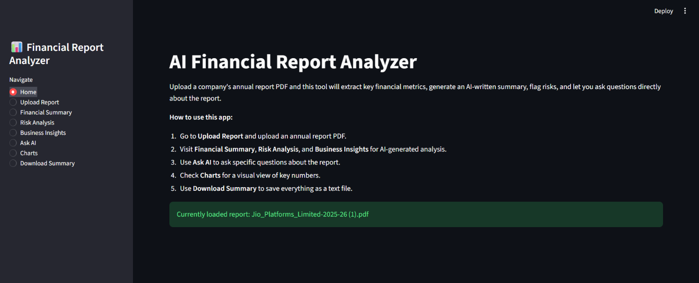

# AI Financial Report Analyzer

An AI-powered financial analysis application built with Streamlit that helps users analyze company annual reports using Large Language Models (LLMs), Retrieval-Augmented Generation (RAG), semantic search, and financial data extraction.

Upload an annual report PDF to generate financial summaries, identify potential risks, explore business segments, visualize financial metrics, and ask questions about the report using AI.



## Key Features

- **PDF Report Upload:** Upload company annual reports in PDF format.
- **AI Financial Summary:** Generate easy-to-understand financial summaries.
- **Risk Analysis:** Identify potential business and financial risks.
- **Business Segment Insights:** Find relevant business and segment information across the extracted report.
- **AI Question Answering:** Ask natural-language questions about uploaded reports using RAG.
- **Financial Metrics Extraction:** Extract selected metrics such as revenue, profit, EPS, debt, assets, and liabilities.
- **Semantic Search:** Retrieve relevant document chunks using FAISS.
- **Interactive Charts:** Visualize extracted financial metrics.
- **Download Summary:** Download generated analysis as a text file.

## Technology Stack

| Category | Technologies |
|---|---|
| Programming Language | Python |
| Frontend | Streamlit |
| LLM API | Groq |
| LLM Model | openai/gpt-oss-20b |
| PDF Processing | PyMuPDF |
| Embeddings | Sentence Transformers |
| Vector Database | FAISS |
| Text Processing | LangChain |
| Data Processing | Pandas, NumPy |
| Visualization | Matplotlib, Plotly |
| Environment Management | Python venv |

## System Architecture

```text
             Annual Report PDF
                     |
                     v
              PDF Extraction
                 (PyMuPDF)
                     |
                     v
               Text Cleaning
                     |
                     v
              Text Chunking
                     |
                     v
             Sentence Embeddings
                     |
                     v
                FAISS Index
                     |
                     v
             Relevant Retrieval
                     |
                     v
                 Groq LLM
                     |
          +----------+----------+
          |          |          |
          v          v          v
       Summary     Risk      Business
                  Analysis   Insights
                     |
                     v
               Streamlit UI
                     |
                     v
              AI Question Answering
```

## How It Works

1. Upload a company annual report PDF.
2. Extract text using PyMuPDF.
3. Clean and preprocess the extracted text.
4. Split the document into smaller overlapping chunks.
5. Generate embeddings using the Sentence Transformers model.
6. Store embeddings in a FAISS vector database.
7. Extract selected financial metrics using regular expressions.
8. Retrieve relevant document chunks for user questions.
9. Send relevant context to the Groq LLM.
10. Display AI-generated summaries, risk analysis, business insights, and answers through Streamlit.

## Project Structure

```text
AI-Financial-Report-Analyzer/
│
├── app/
│   └── app.py
│
├── data/
│   ├── raw/
│   └── processed/
│
├── models/
│   └── index/
│
├── notebooks/
│
├── reports/
│
├── docs/
│   └── images/
│       └── dashboard.png
│
├── src/
│   ├── charts.py
│   ├── chunker.py
│   ├── embeddings.py
│   ├── financial_metrics.py
│   ├── pdf_extractor.py
│   ├── rag_qa.py
│   ├── summary_generator.py
│   ├── text_cleaner.py
│   └── utils.py
│
├── .env.example
├── .gitignore
├── Dockerfile
├── requirements.txt
└── README.md
```

## Installation and Setup

### 1. Clone the Repository

```bash
git clone https://github.com/dheerajkumar25-dev/AI-Financial-Report-Analyzer.git

cd AI-Financial-Report-Analyzer
```

### 2. Create a Virtual Environment

For Windows PowerShell:

```powershell
python -m venv venv

.\venv\Scripts\Activate.ps1
```

For Linux/macOS:

```bash
python3 -m venv venv

source venv/bin/activate
```

### 3. Install Dependencies

```bash
python -m pip install --upgrade pip

pip install -r requirements.txt
```

### 4. Configure Environment Variables

Create a `.env` file using the example:

```powershell
Copy-Item .env.example .env
```

Add your Groq API configuration:

```env
GROQ_API_KEY=your_groq_api_key
GROQ_MODEL=openai/gpt-oss-20b
```

Get your API key from [Groq Console](https://console.groq.com/).

**Important:** Never upload your `.env` file or expose your API key on GitHub.

### 5. Run the Application

```bash
streamlit run app/app.py
```

Open the application at:

```text
http://localhost:8501
```

## Deployment – Streamlit Community Cloud

The application can be deployed using Streamlit Community Cloud.

1. Push the project to GitHub.
2. Visit [Streamlit Community Cloud](https://share.streamlit.io/).
3. Select **Create app**.
4. Select the GitHub repository.
5. Choose the `main` branch.
6. Set the main file path to:

```text
app/app.py
```

7. Open Advanced Settings → Secrets.
8. Add the following configuration:

```toml
GROQ_API_KEY = "your_groq_api_key"
GROQ_MODEL = "openai/gpt-oss-20b"
```

9. Click **Deploy**.

## Design Decisions

- **Regex-based extraction:** Selected financial metrics are extracted using deterministic regular expressions.
- **RAG architecture:** FAISS retrieves relevant document chunks before question answering.
- **Local embeddings:** Sentence Transformers generates embeddings locally without requiring a paid embedding API.
- **Groq inference:** Groq provides LLM inference for financial summaries, risk analysis, business insights, and question answering.
- **Modular structure:** Separate Python modules handle PDF extraction, text processing, embeddings, metrics, and AI generation.

## Limitations

- Regex-based financial metric extraction may not capture every financial reporting format.
- PDF text extraction may not preserve complex tables, charts, or scanned pages accurately.
- Business insights depend on finding relevant information in the extracted report text.
- AI-generated responses may require verification against the original annual report.
- Only one report is analyzed at a time.
- Groq-powered features require internet access and a valid API key.

## Future Improvements

- OCR support for scanned annual reports.
- Advanced financial table extraction.
- Multi-year financial comparison.
- Multi-company report comparison.
- Source-page citations for AI-generated answers.
- Improved full-document summarization.
- Automated testing and evaluation.
- PDF export for generated financial analysis.

## Disclaimer

This project is developed for educational and portfolio purposes. It does not provide investment, accounting, auditing, or legal advice. Always verify extracted financial figures and AI-generated conclusions against the original annual report.

## Author

**Dheeraj Kumar**

B.Tech – Electronics and Communication Engineering  
IIIT Bhagalpur

- GitHub: https://github.com/dheerajkumar25-dev

---

⭐ If you find this project useful, consider giving the repository a star.